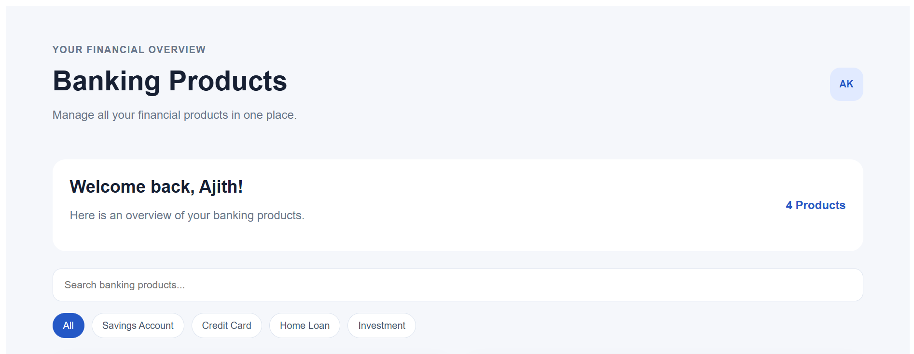
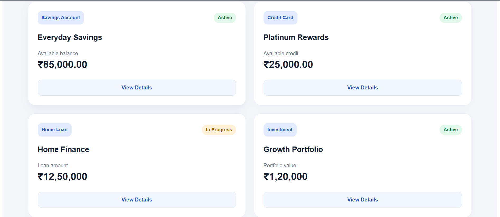

# Banking Products Dashboard

## Project Overview

A responsive banking products dashboard built using Angular. It provides a unified view of different banking products on a single screen.

## Dashboard Preview



## Features

- Displays four banking product types: Savings Account, Credit Card, Loan, and Investment.
- Search products by name.
- Filter products by category.
- Display product name, category, status, and financial metrics.
- View product details in a modal.
- Show a message when no products match the search or filter.
- Responsive layout for mobile, tablet, and desktop screens.
- Uses mock data; no backend is required.

## Technologies Used

- Angular
- TypeScript
- HTML
- SCSS

## Prerequisites

- Node.js
- npm
- Angular CLI

## Getting Started

### 1. Install dependencies

```bash
npm install
```

### 2. Start the development server

```bash
ng serve
```

Open `http://localhost:4200/` in your browser.

## Production Build

Run the following command:

```bash
ng build
```

The production build files are generated in the `dist/` directory.

## Data Source

This project uses hard-coded sample banking product data. No backend API or database is required.

## Author

Ajith Kumar R